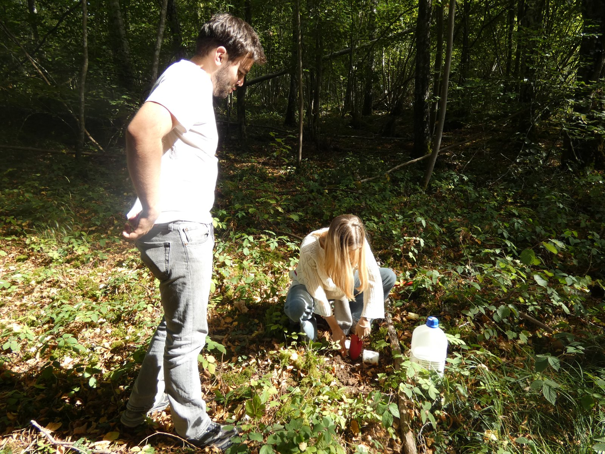
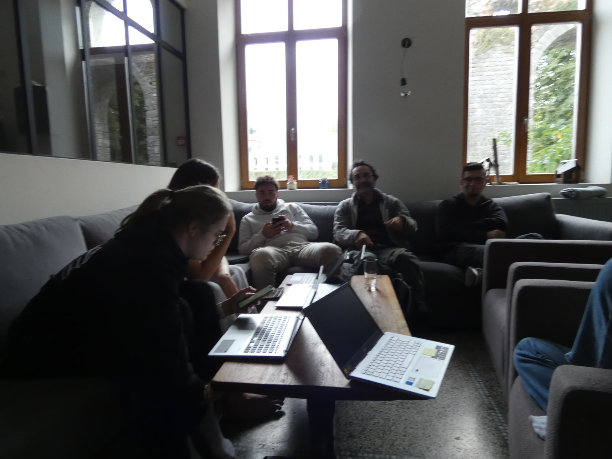

[La formation]{.eyebrow}

# Deux universités. Une même curiosité pour le vivant.

::: {.page-lead}
Le Master en biologie des organismes et écologie réunit l’UCLouvain et l’UNamur autour d’un projet commun : comprendre les organismes, leurs interactions et les écosystèmes qu’ils composent.
:::

::: {.split-section}
::: {}
## Un parcours à votre image

Cette formation de **120 crédits, sur deux années**, associe des bases communes, des enseignements de spécialisation, un mémoire et un stage. Les cours se déroulent à Namur et à Louvain-la-Neuve : étudier en BOE, c’est découvrir deux environnements universitaires.

Le programme est francophone et comprend aussi des activités en anglais. La communication scientifique fait partie de votre formation.
:::
::: {.note-panel}
### Est-ce le master pour vous ?

Vous aimez observer, expérimenter et comprendre ? Vous souhaitez approfondir votre formation en sciences de la vie et travailler sur les enjeux de biodiversité et d’environnement ? Explorez le programme et vérifiez les conditions d’accès correspondant à votre diplôme.

[Consulter les conditions d’accès ↗](https://uclouvain.be/prog-2026-boe2m-cond_adm)
:::
:::

## Deux années pour passer de la question à l’action

::: {.timeline}
::: {.timeline-step}
### 01 — Explorer et choisir

Le début du master permet de découvrir des approches communes et d’affiner vos intérêts. Trois modules de spécialisation, choisis parmi six, donnent une direction personnelle à votre parcours.
:::
::: {.timeline-step}
### 02 — Construire une recherche

Le mémoire commence en première année et prend une place centrale en deuxième année. Vous apprenez à formuler une question, produire des données et discuter vos résultats.
:::
::: {.timeline-step}
### 03 — Se projeter

Le dernier quadrimestre est consacré au stage. Cette immersion nourrit une réflexion sur vos compétences et vos envies professionnelles.
:::
:::

## Apprendre en faisant

Observer un milieu, concevoir une expérience, analyser des résultats, argumenter une interprétation : la formation invite à prendre une part active aux apprentissages. Les activités de terrain et de laboratoire donnent du sens aux connaissances et demandent une présence régulière.

[Explorer le programme officiel 2026–2027 ↗](https://uclouvain.be/prog-2026-boe2m){.button-primary}

## Six domaines pour approfondir vos intérêts

Les présentations du master mettent en avant six modules. Vous en choisissez trois pour orienter votre parcours ; les intitulés et l’organisation en vigueur sont à consulter dans le catalogue officiel.

::: {.module-grid}
- **Modélisation en écologie et évolution** — Modelling in ecology and evolution
- **Écologie du stress et écotoxicologie** — Stress ecology and ecotoxicology
- **Écologie comportementale** — Behavioural ecology
- **Conservation et restauration de la biodiversité**
- **Écologie spatiale et thermique** — Spatial and thermal ecology
- **Écologie moléculaire et génomique de la biodiversité** — Molecular ecology and biodiversity genomics
:::

## Des connaissances pour des questions de société

Conservation de la biodiversité, santé humaine et des écosystèmes (« One Health »), effets des pollutions et du changement climatique, gestion des ressources biologiques : la formation vous donne des outils pour aborder ces enjeux avec une démarche scientifique.

::: {.photo-pair}
{fig-alt="Deux personnes mènent une activité de terrain dans une forêt." loading="lazy"}
{fig-alt="Un groupe travaille autour d’une table dans une salle lumineuse." loading="lazy"}
:::

[Quels métiers après le BOE ? →](debouches.qmd){.button-primary}
