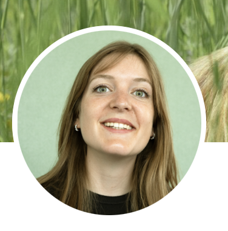
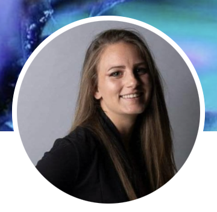
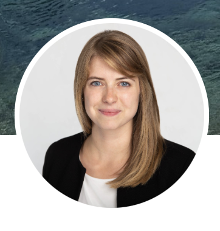
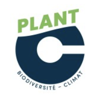
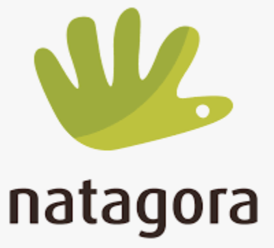
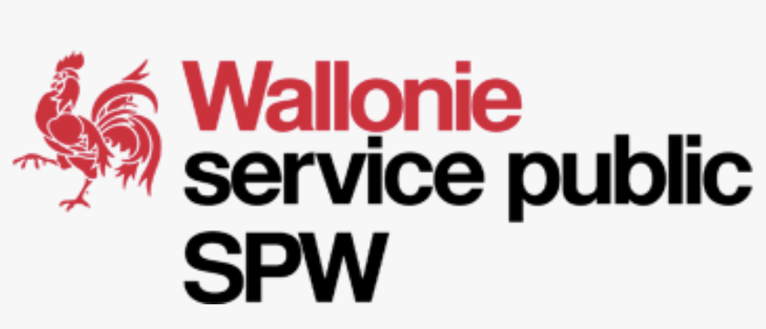

[Après le master]{.eyebrow}

# Les débouchés après le BOE

::: {.page-lead}
La biologie des organismes et l’écologie ouvrent sur des métiers variés. Les parcours de nos alumni montrent comment une formation scientifique peut se prolonger dans la recherche, l’expertise environnementale, la consultance ou l’action publique.
:::

::: {.career-nav}
[Les témoignages](#temoignages) · [Les métiers](#metiers) · [Les employeurs](#employeurs) · [Préparer son parcours](#votre-parcours)
:::

## Ils et elles racontent leur parcours {#temoignages}

Ces expériences illustrent des trajectoires individuelles et les compétences mobilisées au travail. Les fonctions décrites correspondent aux témoignages recueillis ; elles ne constituent pas une liste d’offres d’emploi.

::: {.alumni-profile #sophie-charlotte}
::: {.profile-heading}
[01 / Conseil & territoire]{.eyebrow}

### Sophie-Charlotte Depestel

**Consultance et gestion de projets · BE-MAPS**
:::
::: {.profile-body}
Après un bachelier à l’UNamur et le master BOE à l’UCLouvain, Sophie-Charlotte s’oriente vers la cartographie, les systèmes d’information géographique (SIG) et les projets environnementaux.

**Son quotidien.** Elle accompagne des projets éoliens et agrivoltaïques, des permis d’environnement, des relevés de faune et de flore et des travaux de cartographie. Elle suit ses projets depuis les échanges avec les clients jusqu’aux aspects scientifiques et techniques.

> « Ce qui est important, c’est de développer une démarche scientifique, une capacité d’adaptation et l’envie d’apprendre en permanence. »

**Ce que le BOE lui a apporté.** Une formation polyvalente, un choix de modules permettant de personnaliser son parcours et la complémentarité des deux universités. Son conseil : développer aussi des compétences en SIG, notamment avec QGIS.
:::
:::

::: {.alumni-profile #cassandra}
::: {.profile-heading}
[02 / Écotoxicologie & réglementation]{.eyebrow}

### Cassandra Liévin

**Évaluation des risques environnementaux · SPF Santé publique**
:::
::: {.profile-body}
Diplômée du BOE en 2023, Cassandra a effectué un Erasmus à Montréal et un stage à l’Université de Californie à Davis sur les polluants chez les poissons. Elle rejoint ensuite le SPF Santé publique.

**Son quotidien.** Elle évalue les risques environnementaux des biocides. Comme gestionnaire de dossiers, elle rassemble les avis des experts, échange avec les parties prenantes et prépare des documents d’expertise destinés notamment à l’Agence européenne des produits chimiques (ECHA).

> « Les cours d’écotoxicologie suivis durant mon master me servent énormément au quotidien. »

**Ce qu’elle retient.** La rigueur scientifique, l’efficacité, le travail en réseau et l’accompagnement des enseignants. Elle invite les futurs étudiants à multiplier les expériences, à explorer les possibilités à l’étranger et à oser les candidatures spontanées.
:::
:::

::: {.alumni-profile #anne-sophie}
::: {.profile-heading}
[03 / Recherche & protection de l’eau]{.eyebrow}

### Anne-Sophie Voisin

**Qualité des eaux · Office fédéral de l’environnement, Suisse**
:::
::: {.profile-body}
Après le master BOE, Anne-Sophie réalise un doctorat en écotoxicologie à l’UNamur, puis travaille au Centre Ecotox sur le site de l’Eawag, en Suisse. En mars 2025, elle rejoint l’Office fédéral de l’environnement.

**Son parcours relie recherche et action publique.** Au Centre Ecotox, elle développe des biomarqueurs pour étudier le stress environnemental chez les organismes aquatiques. À l’Office fédéral, elle contribue au suivi de la qualité des eaux de surface, à la coordination de projets scientifiques et à des travaux réglementaires.

**Son conseil.** Cultiver les langues, le réseau professionnel et les sujets qui suscitent votre curiosité. Ses expériences en Suède, aux États-Unis et en Nouvelle-Zélande ont renforcé son autonomie et son ouverture à différentes façons de travailler.

**L’apport du BOE.** La possibilité de combiner écologie et biologie moléculaire, et des bases scientifiques solides pour poursuivre un parcours international.

[Parcours reformulé en français à partir de son témoignage et des éléments biographiques fournis.]{.profile-note}
:::
:::

::: {.alumni-profile #nicolas}
::: {.profile-heading}
[04 / Recherche en conservation]{.eyebrow}

### Nicolas Laurent

**Un parcours doctoral · Open Universiteit**
:::
::: {.profile-body}
Après le BOE, un Erasmus au Québec et un stage en génétique de la conservation en Afrique du Sud, Nicolas rejoint un projet de recherche au Musée des sciences naturelles à Bruxelles, puis entreprend un doctorat à l’Open Universiteit.

**Son travail associe plusieurs approches.** Une partie de sa recherche porte sur l’analyse de l’ADN pour étudier le régime alimentaire des éléphants et des bovins au Kenya. Son parcours comprend du travail en laboratoire à Nairobi, de l’analyse de données et une réflexion sur les dimensions sociales de la conservation.

**Ce que le master lui a apporté.** La possibilité de combiner les méthodes moléculaires, les connaissances en écologie et les SIG. Il recommande d’explorer des expériences différentes lors du mémoire et du stage, pour découvrir les sujets et les façons de travailler qui vous correspondent.

[Témoignage recueilli en mai 2026, présenté sous forme de synthèse.]{.profile-note}
:::
:::

## Quels métiers explorer ? {#metiers}

::: {.career-grid}
::: {.feature}
### Recherche & conservation

Chercheur ou chercheuse dans une université, un institut public ou une équipe de recherche et développement : produire des connaissances, analyser des données et répondre à des questions sur le vivant. Le doctorat constitue une voie de spécialisation après le master.
:::
::: {.feature}
### Études & conseil en environnement

Consultant, consultante ou chargé de projets : réaliser des études, des relevés de biodiversité, de la cartographie et accompagner des projets liés au territoire. Les SIG et la gestion de projets y trouvent une place concrète.
:::
::: {.feature}
### Expertise & évaluation des risques

Expert ou experte scientifique : évaluer les effets de substances sur les organismes, interpréter des résultats et contribuer à des dossiers réglementaires ou au suivi de la qualité des milieux.
:::
::: {.feature}
### D’autres pistes à découvrir

Éco-conseil, éco-pédagogie, biostatistique, assurance qualité : les présentations du programme citent aussi ces pistes. Selon le poste visé, des compétences complémentaires ou une formation supplémentaire peuvent être utiles.
:::
:::

## Où travaillent les alumni ? {#employeurs}

Entreprises, associations et services publics : ces exemples montrent la diversité des environnements professionnels. Les fonctions ci-dessous ont été vérifiées à partir de pages publiques en novembre 2026.

::: {.employer-grid}
::: {.employer-card}

### PlantC

**Clémence Salembier**

Cheffe de projets biodiversité et climat

[Voir la source ↗](https://fr.linkedin.com/posts/plant-c_bienvenue-equipe-plantc-activity-7492859915963752448-GKxP)
:::
::: {.employer-card}

### VIVUS

**Pauline Boulenger**

Ingénieure de projet

[Voir la source ↗](https://vivus.city/equipe/)
:::
::: {.employer-card}

### CRA-W

**Florian Delaite**

Chercheur — sols, eaux et productions intégrées

[Voir la source ↗](https://www.cra.wallonie.be/fr/florian-delaite)
:::
::: {.employer-card}

### Natagora

**Thibaud Vandaudenard**

Entomologie et conservation de la biodiversité

[Voir la source ↗](https://agenda-formulaire.natagora.be/news/une-nouvelle-espece-dabeille-observee-en-belgique)
:::
::: {.employer-card}

### Service public de Wallonie

**Marie Renwart**

Environnement — suivi de la propreté publique

[Voir la source ↗](https://environnement.wallonie.be/actualite/appel-a-projets-mise-en-oeuvre-d-un-plan-local-de-proprete-mesure-de-la-proprete-publique-2026)
:::
::: {.employer-card}

### European Metals

**Lara Van de Merckt**

Conseillère senior — santé, environnement et substances chimiques

[Voir la source ↗](https://european-metals.eu/who-we-are/)
:::
:::

Ces employeurs illustrent des parcours individuels ; leur présence ne signifie pas un partenariat de recrutement avec le master.

## Construire votre parcours dès le master {#votre-parcours}

::: {.feature-grid}
::: {.feature}
### Personnaliser vos compétences

Le choix des modules vous permet d’approfondir vos intérêts. Analyse de données, SIG, communication scientifique et expériences de terrain constituent des compétences à valoriser dans différents contextes.
:::
::: {.feature}
### Explorer grâce au mémoire

Le mémoire permet de découvrir une équipe, une question scientifique et des méthodes de recherche. Vous identifiez aussi les activités qui vous donnent envie d’aller plus loin.
:::
::: {.feature}
### Tester un environnement de travail

Le stage vous aide à confronter vos envies à une expérience concrète. La réflexion sur votre projet professionnel commence pendant le master et accompagne cette exploration.
:::
:::

::: {.callout-band}
## Recherche et expérience professionnelle

Découvrez la place du stage et du mémoire, ou échangez avec l’équipe sur vos intérêts.

[Explorer les stages →](stages.qmd){.button-light}
[Découvrir les mémoires →](memoires.qmd){.light-link}
:::
