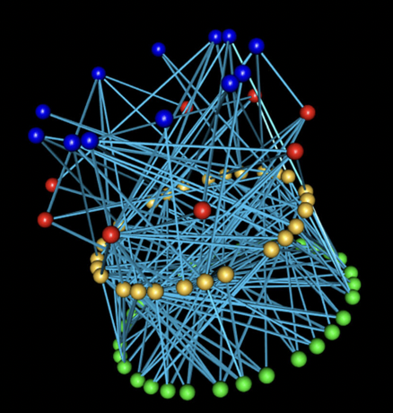
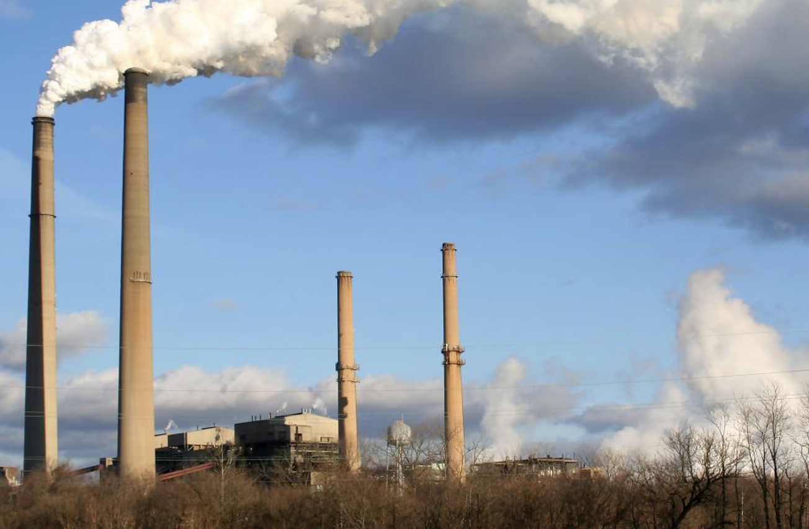
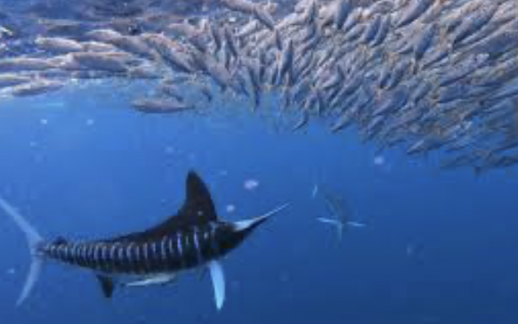
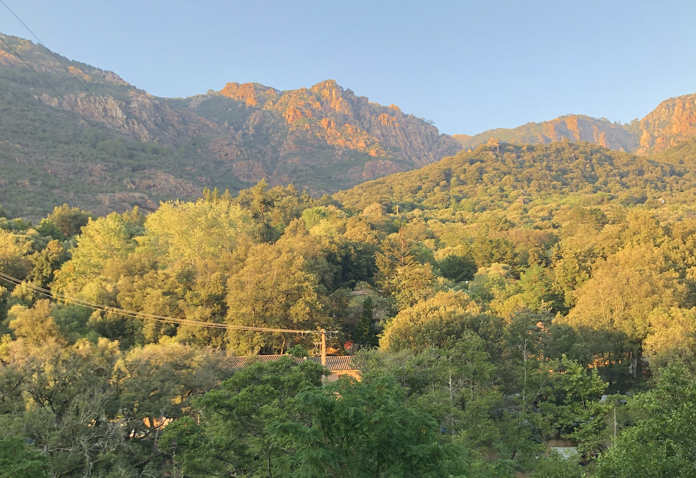
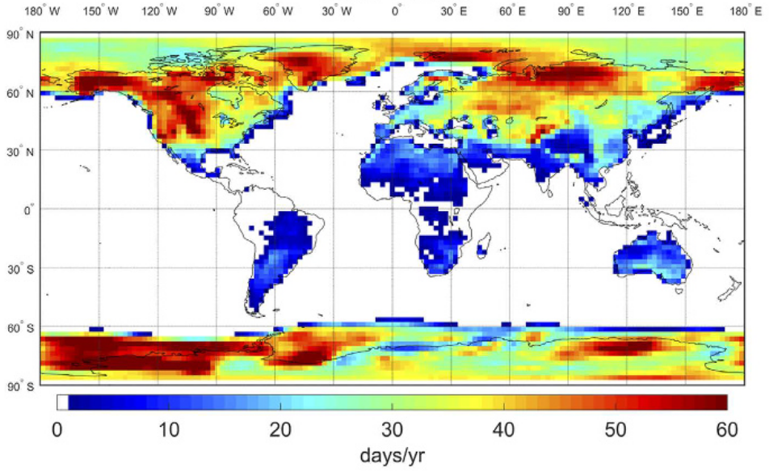
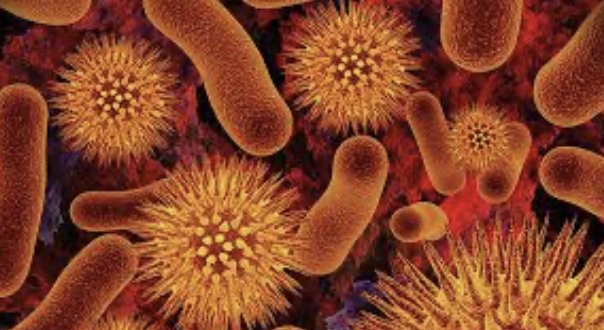

[The programme]{.eyebrow}

# Programme: courses, modules and structure

::: {.page-lead}
The programme combines core courses, three specialisation modules, a research thesis and a four- to six-month professional internship. This page describes the teaching and how it is organised across the two years.
:::

::: {.split-section}
::: {}
## Programme structure

The **120-credit, two-year** programme combines core courses, specialisation modules, a research thesis and a professional internship. Classes take place in Namur and Louvain-la-Neuve.

Teaching is mainly in French and includes activities in English. Scientific communication is part of the training. This English website does not indicate an English-taught degree.
:::
::: {.note-panel}
### Entry requirements

The programme is intended for students wishing to deepen their knowledge of biology, biodiversity and environmental science. Check the official admission requirements for your qualification.

[Official admission requirements ↗](https://uclouvain.be/prog-2026-boe2m-cond_adm)
:::
:::

## The two-year structure

::: {.timeline}
::: {.timeline-step}
### 01 — Core courses and specialisation

Core teaching introduces shared approaches. Three specialisation modules, chosen from six, allow students to develop their interests.
:::
::: {.timeline-step}
### 02 — Research thesis

The thesis starts in the first year and is a major part of the second. Students formulate a question, produce data and discuss their results.
:::
::: {.timeline-step}
### 03 — Professional internship

The final semester is devoted to the internship, providing experience of a professional environment and informing career choices.
:::
:::

## Learning through practice

Observations, experiments, data analysis and scientific argument are central to the programme. Field and laboratory activities connect knowledge with practice and require regular attendance.

[Official programme for 2026–2027 ↗](https://uclouvain.be/prog-2026-boe2m){.button-primary}

## Six areas of specialisation

Choose three eight-credit modules from six areas.

::: {.module-cards}
::: {.module-card}
{fig-alt="A network of ecological interactions." loading="lazy"}

### Modelling in ecology and evolution

Explore interactions between species using models and simulations.
:::
::: {.module-card}
{fig-alt="Industrial chimneys emitting smoke." loading="lazy"}

### Stress ecology and ecotoxicology

Study how organisms and ecosystems respond to disturbances.
:::
::: {.module-card}
{fig-alt="A predator among a school of fish." loading="lazy"}

### Behavioural ecology

Relate behaviour to interactions between organisms and their environment.
:::
::: {.module-card}
{fig-alt="Forest and mountain landscape." loading="lazy"}

### Biodiversity conservation and restoration

Study natural environments and approaches to conserving their diversity.
:::
::: {.module-card}
{fig-alt="World map showing spatial variation in a climatic indicator." loading="lazy"}

### Spatial and thermal ecology

Examine the roles of space and temperature in biological systems.
:::
::: {.module-card}
{fig-alt="Illustration of microorganisms from the programme presentation." loading="lazy"}

### Molecular ecology and biodiversity genomics

Connect biodiversity with molecular methods and genomics.
:::
:::

[Courses and organisation in the official catalogue ↗](https://uclouvain.be/prog-2026-boe2m)

## Scientific approaches to societal questions

Biodiversity conservation, human and ecosystem health (One Health), pollution, climate change and biological resource management are among the issues addressed in the programme.

[Careers after BOE →](debouches.qmd){.button-primary}
[The field course in pictures →](terrain.qmd){.button-primary}
