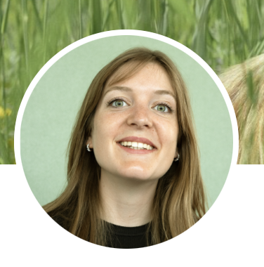
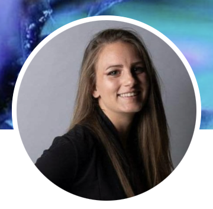
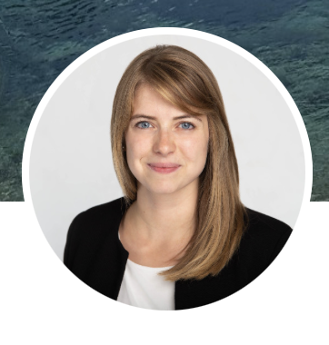
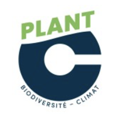
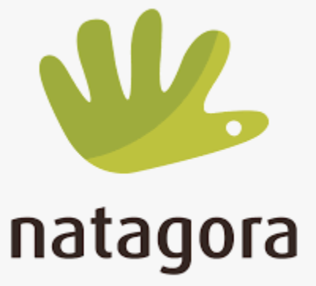

[After the master's degree]{.eyebrow}

# Careers after BOE

::: {.page-lead}
BOE graduates work in research, environmental consultancy, scientific assessment and public services, among other fields. The accounts below illustrate individual experiences.
:::

::: {.career-nav}
[Alumni accounts](#temoignages) · [Career fields](#metiers) · [Employers](#employeurs) · [Preparing for work](#votre-parcours)
:::

## Alumni accounts {#temoignages}

These accounts illustrate individual careers and skills used at work. Roles are described as reported in the interviews; they are not job vacancies. Quotations have been translated from French.

::: {.alumni-profile #sophie-charlotte}
::: {.profile-heading}
[01 / Environmental consultancy]{.eyebrow}

### Sophie-Charlotte Depestel

**Consultancy and project management · BE-MAPS**
:::
::: {.profile-body}
After a bachelor's degree at UNamur and the BOE master's at UCLouvain, Sophie-Charlotte moved into mapping, geographical information systems (GIS) and environmental projects.

**Her work.** She supports wind and agrivoltaic projects, environmental permit applications, fauna and flora surveys and mapping. Her responsibilities span client discussions and scientific and technical aspects.

> “What matters is developing a scientific approach, adaptability and a willingness to keep learning.”

**What BOE contributed.** Broad scientific training, module choices that allowed her to shape her studies, and complementary expertise from the two universities. She also recommends developing GIS skills, particularly with QGIS.
:::
:::

::: {.alumni-profile #cassandra}
::: {.profile-heading}
[02 / Ecotoxicology and regulation]{.eyebrow}

### Cassandra Liévin

**Environmental risk assessment · Belgian Federal Public Service Health**
:::
::: {.profile-body}
Cassandra graduated from BOE in 2023, following an Erasmus exchange in Montréal and an internship at the University of California, Davis, studying pollutants in fish. She then joined the Belgian Federal Public Service Health.

**Her work.** She assesses environmental risks from biocides. As a dossier manager, she brings together expert opinions, engages with stakeholders and prepares scientific documents, including for the European Chemicals Agency (ECHA).

> “The ecotoxicology courses I took during my master's are extremely useful in my everyday work.”

**What she values.** Scientific rigour, efficient working methods, networking and support from teaching staff. She encourages students to try different experiences, explore opportunities abroad and send speculative applications.
:::
:::

::: {.alumni-profile #anne-sophie}
::: {.profile-heading}
[03 / Research and water protection]{.eyebrow}

### Anne-Sophie Voisin

**Water quality · Federal Office for the Environment, Switzerland**
:::
::: {.profile-body}
After BOE, Anne-Sophie completed a PhD in ecotoxicology at UNamur, then worked at the Ecotox Centre on the Eawag site in Switzerland. In March 2025, she joined the Federal Office for the Environment.

**Connecting research and public policy.** At the Ecotox Centre, she developed biomarkers to study environmental stress in aquatic organisms. At the Federal Office, she contributes to surface-water quality monitoring, scientific project coordination and regulatory work.

**Her advice.** Develop language skills, professional networks and research interests. Experiences in Sweden, the United States and New Zealand strengthened her independence and familiarity with different working practices.

**What BOE contributed.** The opportunity to combine ecology and molecular biology, and a scientific foundation for an international career.

[Summary based on her account and supplied biographical material.]{.profile-note}
:::
:::

::: {.alumni-profile #nicolas}
::: {.profile-heading}
[04 / Conservation research]{.eyebrow}

### Nicolas Laurent

**Doctoral research · Open Universiteit**
:::
::: {.profile-body}
After BOE, an Erasmus exchange in Québec and an internship in conservation genetics in South Africa, Nicolas joined a research project at the natural sciences museum in Brussels before starting a PhD at the Open Universiteit.

**Combining approaches.** Part of his research uses DNA analysis to study elephant and cattle diets in Kenya. His experience includes laboratory work in Nairobi, data analysis and consideration of the social dimensions of conservation.

**What BOE contributed.** The opportunity to combine molecular methods, ecological knowledge and GIS. He recommends trying different research and working approaches through the thesis and internship.

[Account collected in May 2026 and presented as a summary.]{.profile-note}
:::
:::

## Career fields {#metiers}

::: {.career-grid}
::: {.feature}
### Research and conservation

Researchers in universities, public institutes or research and development teams produce knowledge, analyse data and investigate biological questions. A PhD is one route to further specialisation after the master's.
:::
::: {.feature}
### Environmental studies and consultancy

Consultants and project officers carry out assessments, biodiversity surveys and mapping, and support land-use projects. GIS and project management are relevant skills.
:::
::: {.feature}
### Scientific assessment and risk evaluation

Scientific specialists assess the effects of substances on organisms, interpret results and contribute to regulatory dossiers or environmental quality monitoring.
:::
::: {.feature}
### Other fields

Environmental education, environmental advice, biostatistics and quality assurance are further possibilities identified in programme materials. Some roles may require additional skills or training.
:::
:::

## Examples of alumni employers {#employeurs}

These companies, associations and public services illustrate different working environments. The roles below were checked against public sources in November 2026.

::: {.employer-grid}
::: {.employer-card}

### PlantC

**Clémence Salembier**

Biodiversity and climate project manager

[Source ↗](https://fr.linkedin.com/posts/plant-c_bienvenue-equipe-plantc-activity-7492859915963752448-GKxP)
:::
::: {.employer-card}

### VIVUS

**Pauline Boulenger**

Project engineer

[Source ↗](https://vivus.city/equipe/)
:::
::: {.employer-card}

### CRA-W

**Florian Delaite**

Researcher — soils, water and integrated production

[Source ↗](https://www.cra.wallonie.be/fr/florian-delaite)
:::
::: {.employer-card}

### Natagora

**Thibaud Vandaudenard**

Entomology and biodiversity conservation

[Source ↗](https://agenda-formulaire.natagora.be/news/une-nouvelle-espece-dabeille-observee-en-belgique)
:::
::: {.employer-card}

### Service public de Wallonie

**Marie Renwart**

Environment — public cleanliness monitoring

[Source ↗](https://environnement.wallonie.be/actualite/appel-a-projets-mise-en-oeuvre-d-un-plan-local-de-proprete-mesure-de-la-proprete-publique-2026)
:::
::: {.employer-card}

### European Metals

**Lara Van de Merckt**

Senior policy adviser — health, environment and chemicals

[Source ↗](https://european-metals.eu/who-we-are/)
:::
:::

These employers illustrate individual careers; inclusion does not imply a recruitment partnership with the programme.

## Preparing for work during the programme {#votre-parcours}

::: {.feature-grid}
::: {.feature}
### Developing skills

Module choices allow students to develop their interests. Data analysis, GIS, scientific communication and field experience are useful in different professional contexts.
:::
::: {.feature}
### Research experience

The thesis introduces a research team, a scientific question and research methods. It also helps students identify the activities they wish to pursue.
:::
::: {.feature}
### Experience of a workplace

The internship provides practical experience against which to assess career plans. Career reflection starts during the programme and develops through these experiences.
:::
:::

::: {.callout-band}
## Research and professional experience

Find out about the internship and thesis, or discuss your interests with the team.

[Professional internship →](stages.qmd){.button-light}
[Master's theses →](memoires.qmd){.light-link}
:::
