[Teaching and research teams]{.eyebrow}

# Programme contacts and thesis supervisors

::: {.page-lead}
BOE supervisors at UCLouvain and UNamur bring together complementary research specialties and support students in developing scientific projects.
:::

## Programme and annual study plan contacts

::: {.feature-grid}
::: {.feature}
[UNamur]{.eyebrow}

### Frederik De Laender

**BOE programme coordinator at UNamur**

For questions about the programme, your study plans and the opportunities offered by the degree.
:::
::: {.feature}
[UCLouvain]{.eyebrow}

### Hans Van Dyck

**BOE programme coordinator at UCLouvain**

For guidance on the programme and discussions about your background and interests.
:::
::: {.feature}
[Annual study plan]{.eyebrow}

### Renate Wesselingh

**Chair of the BOE examination board · PAE enquiries**

Contact for questions about the annual study plan (programme annuel de l’étudiant, PAE), individual study pathways and course selection.
:::
:::

## Research specialties

Thesis supervision covers field ecology, genomics, animal behaviour and plant physiology. Students also work with researchers and doctoral students in their host teams.

## At UNamur

::: {.people-grid}
::: {.person}

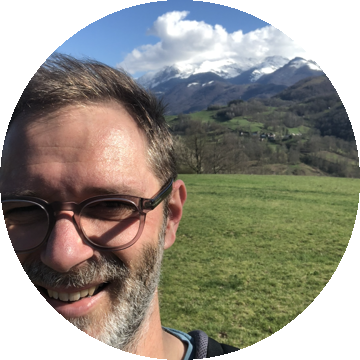

### Frederik De Laender

**Biodiversity and ecosystem functioning**

His research examines how ecological communities assemble and respond to disturbances. Experiments and models connect species diversity with ecosystem functioning.
:::
::: {.person}

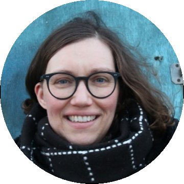

### Alice Dennis

**Genomics and adaptation**

She studies adaptation to environmental constraints, particularly in aquatic invertebrates. Her work combines experiments, genomics and bioinformatics to understand differences in responses among organisms.

[Research information ↗](https://www.unamur.be/fr/newsroom/femmes-et-sciences-2023-portraits-de-chercheuses){.text-link}
:::
::: {.person}

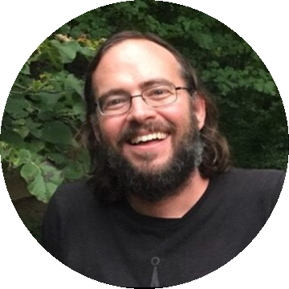

### Brendan Reid

**Conservation genetics**

He uses genomic data, environmental DNA and museum collections to study the effects of environmental change on biodiversity. His work focuses particularly on fish, reptiles and amphibians and informs their conservation.

[Research information ↗](https://www.unamur.be/en/science/biology/research/urbe/brendan-reid){.text-link}
:::
::: {.person}

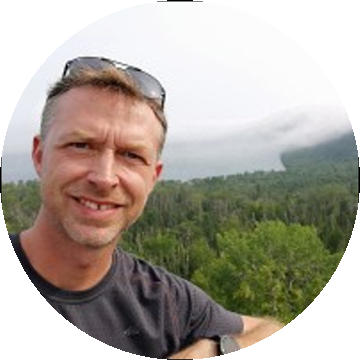

### Frédéric Silvestre

**Environmental physiology and epigenetics**

He explores the mechanisms linking environment, animal physiology and behaviour. His research examines lasting effects of stress and the role of epigenetics in responses to environmental change.
:::
::: {.person}

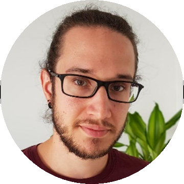

### Eli Thoré

**Ecotoxicology and animal behaviour**

He studies how animals, particularly aquatic species, respond to human-driven environmental change. His approach links behaviour, ecology and pollutant effects to understand the consequences of these pressures.

[Research information ↗](https://www.unamur.be/en/science/biology/research/urbe/eli-thore){.text-link}
:::
:::

## At UCLouvain

::: {.people-grid}
::: {.person}

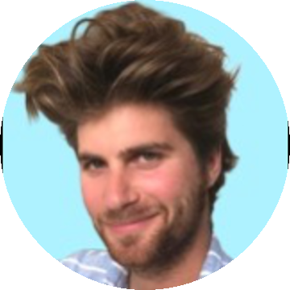

### Simon Baeckens

**Animal evolutionary ecology**

His research explores relationships between animal traits, behaviour and environment, particularly in reptiles. Fieldwork and experiments investigate responses to contrasting environments and human activities.

[Research information ↗](https://www.simonbaeckens.com/people.html){.text-link}
:::
::: {.person}

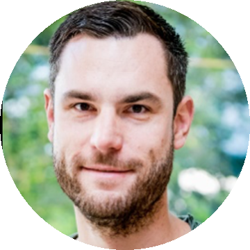

### Ruben Evens

**Movement and nocturnal ecology**

He studies movement, activity rhythms and behaviour in birds and insects. Tracking and field observations reveal relationships with light, resources and habitat change.
:::
::: {.person}
### Thierry Hance

**Insect ecology and biological control**

His research concerns interactions between insects and their use in biological control. Relationships between pests, natural enemies and microorganisms connect ecological questions with crop protection.
:::
::: {.person}

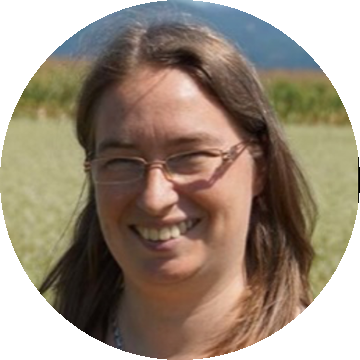

### Muriel Quinet

**Plant physiology and reproduction**

She studies plant development and reproduction under environmental constraints. Her work examines physiological stress responses and relationships between plant functioning and growing conditions.

[Research information ↗](https://uclouvain.be/en/research-institutes/eli/elia/recherches){.text-link}
:::
::: {.person}

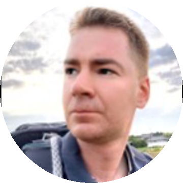

### François Renoz

**Insect–bacterial symbioses**

He explores the origins and evolution of insect–bacterial associations. His research investigates how environmental conditions can transform these relationships and favour lasting symbioses.

[Research information ↗](https://www.frs-fnrs.be/fr/news/francois-renoz-uclouvain-linterview-cqfd){.text-link}
:::
::: {.person}

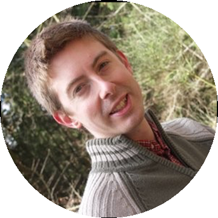

### Nicolas Schtickzelle

**Population dynamics and conservation**

He studies dispersal, habitat choice and population persistence in fragmented landscapes. His research combines field observations, experimental systems and quantitative analysis to address conservation questions.
:::
::: {.person}

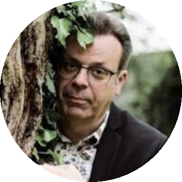

### Hans Van Dyck

**Behavioural ecology and environmental change**

He studies how animals perceive and use their environment, particularly butterflies. His research links behaviour, microclimate and resources to understand the effects of landscape change on biodiversity.
:::
::: {.person}

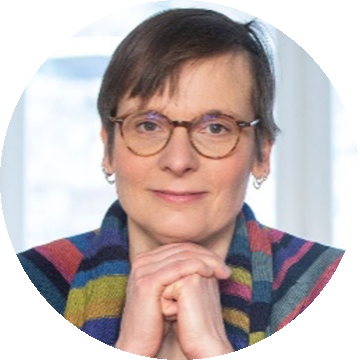

### Sophie Vanwambeke

**Health geography and disease ecology**

She studies relationships between landscapes, environment and disease risk, particularly vector-borne diseases. Spatial data help explain interactions between human health, animal health and environmental change.

[Research information ↗](https://www.elic.ucl.ac.be/index.php?id=110){.text-link}
:::
::: {.person}

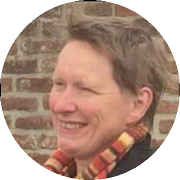

### Renate Wesselingh

**Evolutionary ecology and plant reproduction**

She explores plant reproduction and its environmental context, including germination, flowering, pollination and breeding systems. Experiments and observations examine their ecological and evolutionary consequences.
:::
:::

## Supervision throughout the programme

Supervisory teams help students define research questions, choose methods and develop scientific independence.

::: {.callout-band}
## Thesis research themes

Explore the research areas and methods available within the programme.

[Master's theses →](memoires.qmd){.button-light}
:::
