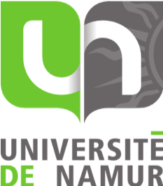
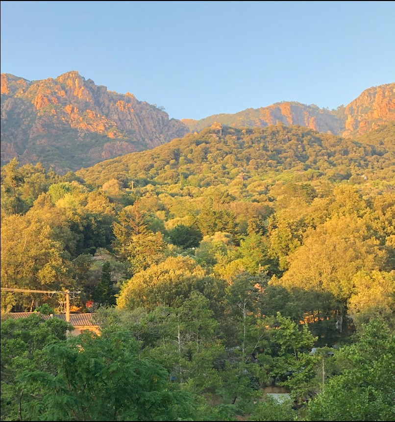
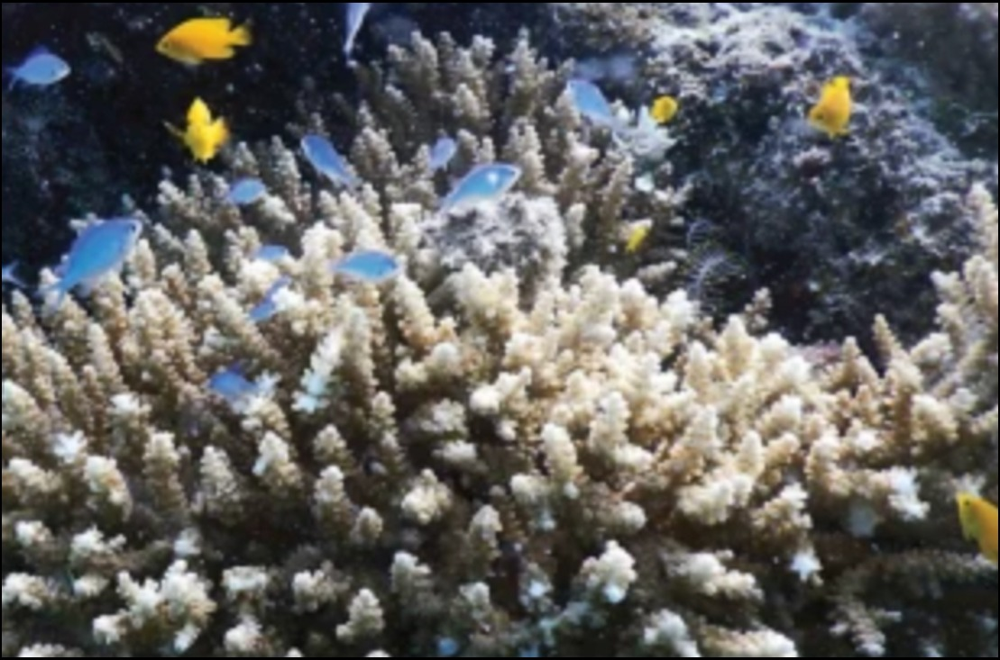
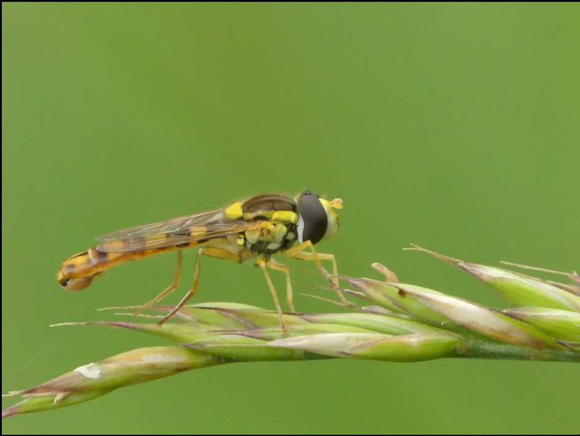

::: {.hero}
::: {.hero-copy}
::: {.partner-logos}

:::

[UCLouvain · UNamur]{.eyebrow}

# Master in Organismal Biology and Ecology

::: {.lead}
A joint programme at UCLouvain and UNamur
:::

A two-year programme covering organisms, their interactions and ecosystems, combining coursework, fieldwork, laboratory research and a professional internship.

[Programme overview →](a-propos.qmd){.button-primary}
[Admission requirements →](liens.qmd#admission){.text-link}
:::
::: {.hero-art .biodiversity-mosaic}

Organisms, interactions and ecosystems.

:::
:::

::: {.facts}
::: {.fact}
**120**

ECTS credits
:::
::: {.fact}
**2 years**

of study
:::
::: {.fact}
**2 universities**

Namur & Louvain-la-Neuve
:::
::: {.fact}
**Fieldwork & research**

throughout the programme
:::
:::

::: {.heritage-banner}
[Since 2007]{.heritage-date}

A joint UCLouvain–UNamur master's programme in organismal biology and ecology.
:::

::: {.section-intro}
[Studying biology and ecology]{.eyebrow}

## Coursework, research and professional experience

The programme examines biodiversity, interactions between organisms and the functioning of natural environments. Students learn to formulate scientific questions, collect and analyse data, and critically assess results.
:::

::: {.feature-grid}
::: {.feature}
[01 / Coursework]{.eyebrow}

### Core courses and specialisation

Study terrestrial and aquatic environments and choose modules according to your interests.

[The programme →](a-propos.qmd)

[The field course in pictures →](terrain.qmd)
:::
::: {.feature}
[02 / Research]{.eyebrow}

### The master's thesis

Join a research team and develop an independent project with scientific supervision.

[Master's theses →](memoires.qmd)
:::
::: {.feature}
[03 / Professional experience]{.eyebrow}

### A four-month internship

Apply your skills in a professional setting and assess your interests and career plans.

[Professional internships →](stages.qmd)
:::
:::

::: {.career-teaser}
::: {}
[After BOE]{.eyebrow}

## Careers and alumni experiences

Environmental risk assessment, environmental consultancy, water protection and conservation research are among the fields illustrated by our alumni accounts.

[Careers and alumni accounts →](debouches.qmd){.button-primary}
:::
::: {.teaser-quote}
> “What matters is developing a scientific approach, adaptability and a willingness to keep learning.”

**Sophie-Charlotte Depestel**  
Consultancy and project management at BE-MAPS

[Translated from her French account.]{.profile-note}
:::
:::

::: {.callout-band}
## Admission and programme enquiries

Consult the admission requirements or discuss the programme with its coordinators. Teaching is mainly in French, with some activities in English.

[Admission information →](liens.qmd#admission){.button-light}
[Programme contacts](equipe.qmd){.light-link}
:::
