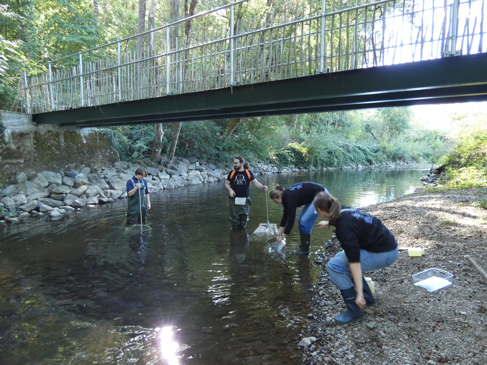
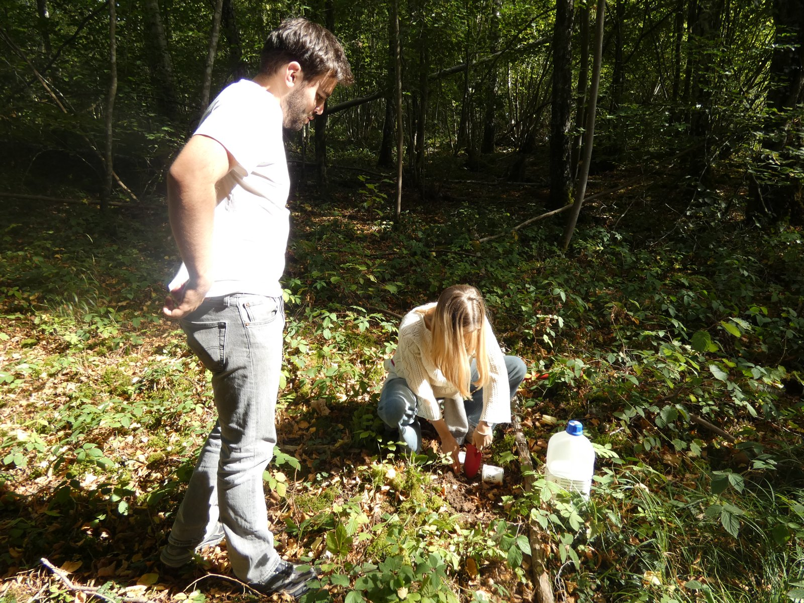
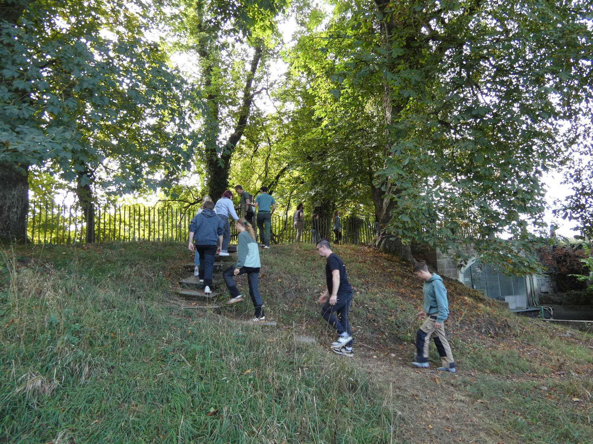
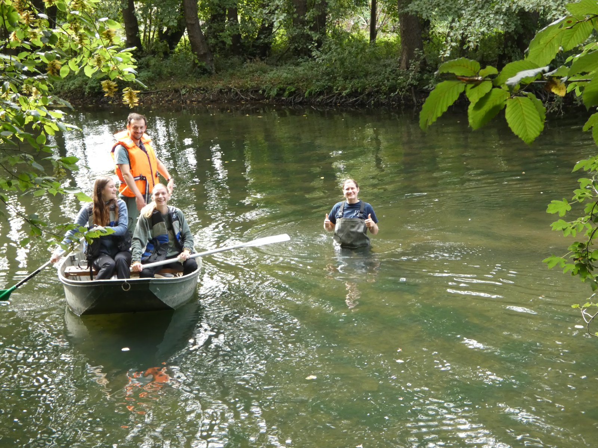
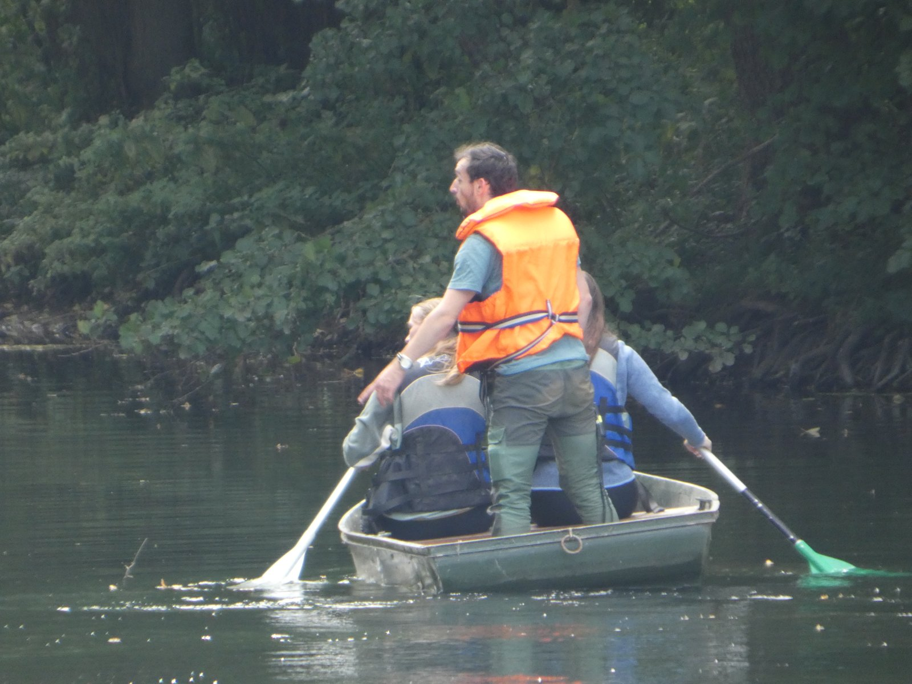
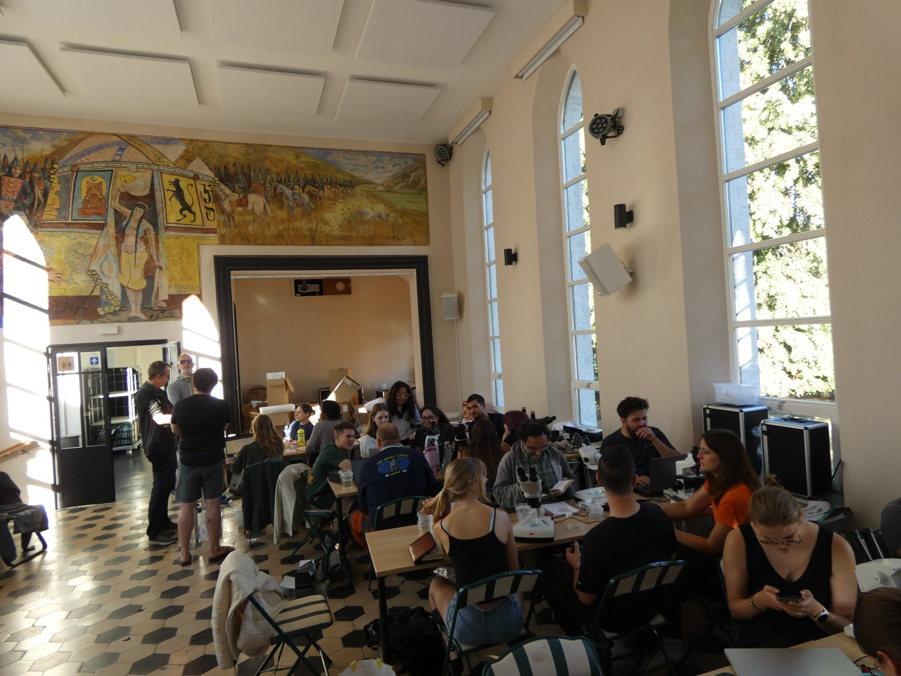
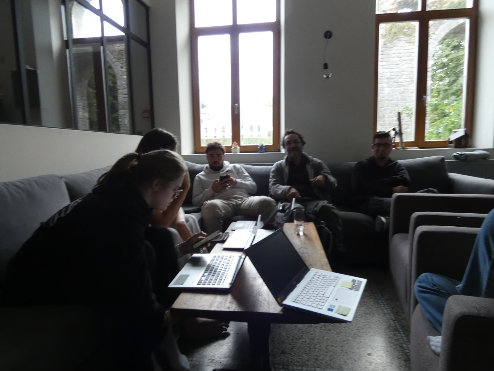

[Field-based learning]{.eyebrow}

# The integrated ecology field course

::: {.page-lead}
The integrated ecology field course is part of the core programme. It introduces field observations and collective work early in the degree.
:::

::: {.field-photo}
{fig-alt="A group works in a shallow river beneath a footbridge."}
:::

::: {.split-section}
::: {}
## Studying environments in the field

Fieldwork requires observation, attention to environmental conditions, decisions about what to measure and discussion of the conclusions supported by the observations.

This collective experience connects coursework with the variety of situations encountered in natural environments.
:::
::: {.note-panel}
### Two complementary experiences

The **integrated ecology field course** is a collective teaching activity. The **second-year professional internship** is an individual placement in a host organisation.

[Professional internship →](stages.qmd)
:::
:::

## Fieldwork and group activities

<figure class="terrain-tile"><figcaption>Exploring woodland.</figcaption></figure>
<figure class="terrain-tile"><figcaption>Observing landscapes and habitats.</figcaption></figure>
<figure class="terrain-tile"><figcaption>Studying aquatic environments.</figcaption></figure>
<figure class="terrain-tile"><figcaption>Observing from the water.</figcaption></figure>
<figure class="terrain-tile"><figcaption>Sharing observations.</figcaption></figure>
<figure class="terrain-tile"><figcaption>Analysing and discussing as a team.</figcaption></figure>

::: {.callout-band}
## Fieldwork and thesis research

The thesis allows students to investigate a scientific question using fieldwork, laboratory work or modelling, depending on the topic.

[Research themes for theses →](memoires.qmd#exemples){.button-light}
:::
