[Des personnes pour vous accompagner]{.eyebrow}

# La science se construit ensemble.

::: {.page-lead}
À l’UCLouvain et à l’UNamur, les promotrices et promoteurs du BOE explorent le vivant sous des angles complémentaires. Leurs équipes vous accompagnent pour transformer votre curiosité en démarche scientifique.
:::

## Vos interlocuteurs pour le programme et le PAE

::: {.feature-grid}
::: {.feature}
[UNamur]{.eyebrow}

### Frederik De Laender

**Responsable du programme BOE à l’UNamur**

Pour discuter de la formation, de votre projet d’études et des possibilités offertes par le master.
:::
::: {.feature}
[UCLouvain]{.eyebrow}

### Hans Van Dyck

**Responsable du programme BOE à l’UCLouvain**

Pour vous orienter dans le programme et échanger sur votre parcours et vos centres d’intérêt.
:::
::: {.feature}
[Programme annuel de l’étudiant]{.eyebrow}

### Renate Wesselingh

**Présidente du jury BOE · Questions relatives au PAE**

Votre interlocutrice pour les questions concernant le programme annuel de l’étudiant (PAE), la composition de votre parcours et le choix des unités d’enseignement.
:::
:::

## Des spécialités pour nourrir votre projet

Du terrain à la génomique, du comportement animal à la physiologie végétale, découvrez les domaines de recherche des scientifiques qui encadrent les mémoires. Au fil de votre projet, vous bénéficiez aussi des échanges avec les chercheuses, chercheurs, doctorantes et doctorants de leur équipe.

## À l’UNamur

::: {.people-grid}
::: {.person}

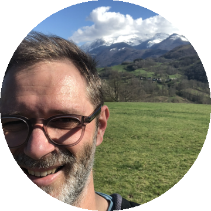

### Frederik De Laender

**Biodiversité et fonctionnement des écosystèmes**

Ses recherches cherchent à comprendre comment les communautés écologiques se constituent et répondent aux perturbations. Elles associent expériences et modèles pour relier la diversité des espèces au fonctionnement des écosystèmes.
:::
::: {.person}

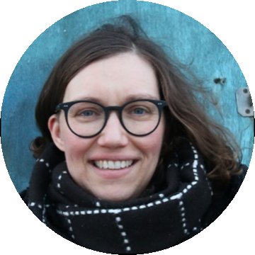

### Alice Dennis

**Génomique et adaptation**

Elle étudie les mécanismes de l’adaptation aux contraintes environnementales, notamment chez les invertébrés aquatiques. Ses travaux combinent expériences, génomique et bioinformatique pour comprendre les différences de réponse entre organismes.

[En savoir plus sur ses recherches ↗](https://www.unamur.be/fr/newsroom/femmes-et-sciences-2023-portraits-de-chercheuses){.text-link}
:::
::: {.person}

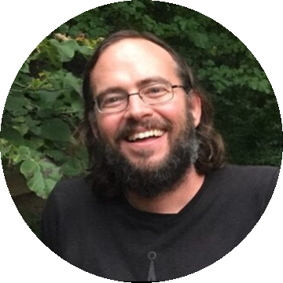

### Brendan Reid

**Génétique de la conservation**

Il utilise les données génomiques, l’ADN environnemental et les collections de musées pour comprendre les effets des changements environnementaux sur la biodiversité. Ses recherches portent notamment sur les poissons, les reptiles et les amphibiens et contribuent à éclairer leur conservation.

[En savoir plus sur ses recherches ↗](https://www.unamur.be/en/science/biology/research/urbe/brendan-reid){.text-link}
:::
::: {.person}

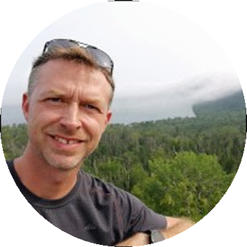

### Frédéric Silvestre

**Physiologie environnementale et épigénétique**

Il explore les mécanismes qui relient l’environnement, la physiologie et le comportement des animaux. Ses recherches s’intéressent notamment aux effets durables du stress et au rôle de l’épigénétique dans les réponses aux changements environnementaux.
:::
::: {.person}

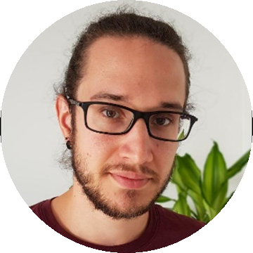

### Eli Thoré

**Écotoxicologie et comportement animal**

Il étudie la façon dont les animaux, notamment aquatiques, réagissent aux changements environnementaux liés aux activités humaines. Son approche relie comportement, écologie et effets des polluants pour mieux comprendre les conséquences de ces pressions sur le vivant.

[En savoir plus sur ses recherches ↗](https://www.unamur.be/en/science/biology/research/urbe/eli-thore){.text-link}
:::
:::

## À l’UCLouvain

::: {.people-grid}
::: {.person}

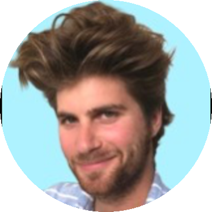

### Simon Baeckens

**Écologie évolutive animale**

Ses recherches explorent les relations entre les caractéristiques des animaux, leurs comportements et leur environnement, notamment chez les reptiles. Elles combinent terrain et expérimentation pour comprendre les réponses à des milieux contrastés ou transformés par les activités humaines.

[En savoir plus sur ses recherches ↗](https://www.simonbaeckens.com/people.html){.text-link}
:::
::: {.person}

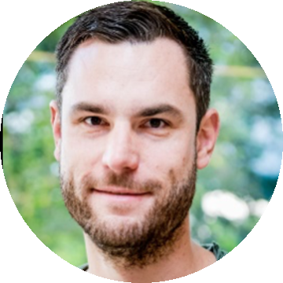

### Ruben Evens

**Écologie du mouvement et de la vie nocturne**

Il étudie les déplacements, les rythmes d’activité et les comportements des oiseaux et des insectes. Le suivi des animaux et l’observation de terrain permettent d’explorer leurs relations avec la lumière, les ressources et les changements de leur habitat.
:::
::: {.person}
### Thierry Hance

**Écologie des insectes et lutte biologique**

Ses travaux portent sur les interactions entre insectes et sur leur utilisation en lutte biologique. Les relations entre ravageurs, ennemis naturels et microorganismes permettent de relier des questions d’écologie à la protection des cultures.
:::
::: {.person}

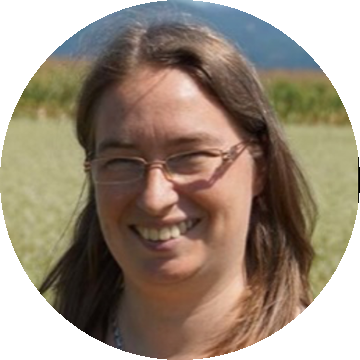

### Muriel Quinet

**Physiologie et reproduction végétales**

Elle s’intéresse à la façon dont les plantes se développent et se reproduisent dans des environnements contraignants. Ses recherches abordent leurs réponses physiologiques aux stress et les liens entre fonctionnement des plantes et conditions de croissance.

[En savoir plus sur ses recherches ↗](https://uclouvain.be/en/research-institutes/eli/elia/recherches){.text-link}
:::
::: {.person}

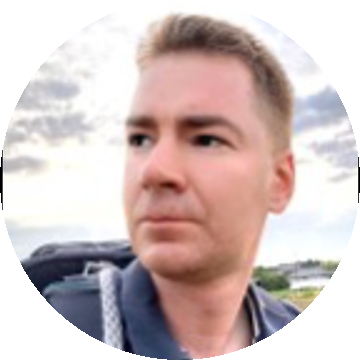

### François Renoz

**Symbioses entre insectes et bactéries**

Il explore l’origine et l’évolution des associations entre insectes et bactéries. Ses travaux cherchent notamment à comprendre comment les conditions environnementales peuvent transformer ces relations et favoriser des symbioses durables.

[En savoir plus sur ses recherches ↗](https://www.frs-fnrs.be/fr/news/francois-renoz-uclouvain-linterview-cqfd){.text-link}
:::
::: {.person}

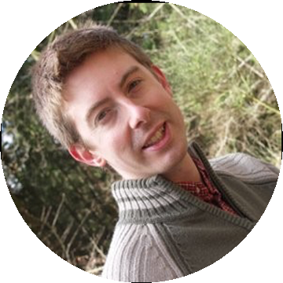

### Nicolas Schtickzelle

**Dynamique des populations et conservation**

Il étudie la dispersion, le choix d’habitat et la persistance des populations dans des paysages fragmentés. Ses recherches associent observations de terrain, systèmes expérimentaux et analyses quantitatives pour comprendre les enjeux de conservation.
:::
::: {.person}

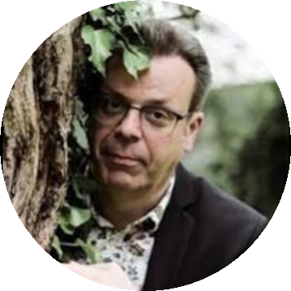

### Hans Van Dyck

**Écologie comportementale et changements environnementaux**

Il s’intéresse à la façon dont les animaux perçoivent et utilisent leur environnement, notamment chez les papillons. Ses recherches relient comportement, microclimat et ressources pour comprendre les effets de la transformation des paysages sur la biodiversité.
:::
::: {.person}

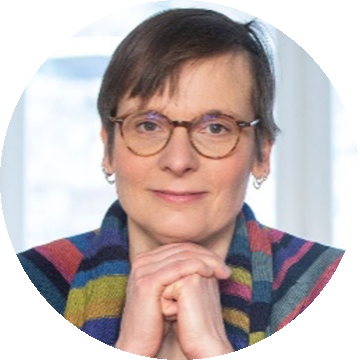

### Sophie Vanwambeke

**Géographie de la santé et écologie des maladies**

Elle étudie les liens entre paysages, environnement et risques de maladies, notamment celles transmises par des vecteurs. Ses travaux mobilisent les données spatiales pour comprendre les interactions entre santé humaine, santé animale et changements environnementaux.

[En savoir plus sur ses recherches ↗](https://www.elic.ucl.ac.be/index.php?id=110){.text-link}
:::
::: {.person}

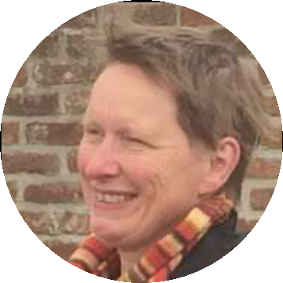

### Renate Wesselingh

**Écologie évolutive et reproduction des plantes**

Elle explore la reproduction des plantes et ses liens avec leur environnement : germination, floraison, pollinisation et systèmes de reproduction. Ses recherches associent expériences et observations pour comprendre les conséquences écologiques et évolutives de ces processus.
:::
:::

## Un accompagnement tout au long du parcours

Les équipes d’encadrement vous aident à préciser votre question de recherche, à choisir vos méthodes et à développer votre autonomie scientifique.

::: {.callout-band}
## Quel domaine vous donne envie d’aller plus loin ?

Découvrez les grands horizons de recherche du mémoire et les approches que vous pourrez explorer pendant le master.

[Explorer les mémoires →](memoires.qmd){.button-light}
:::
