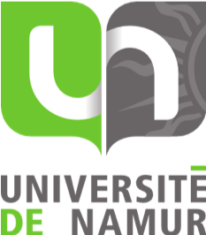
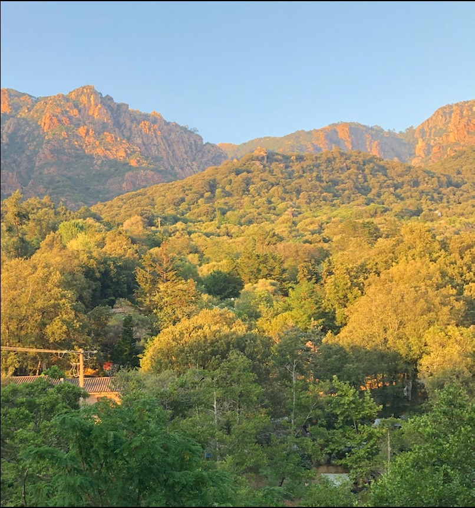
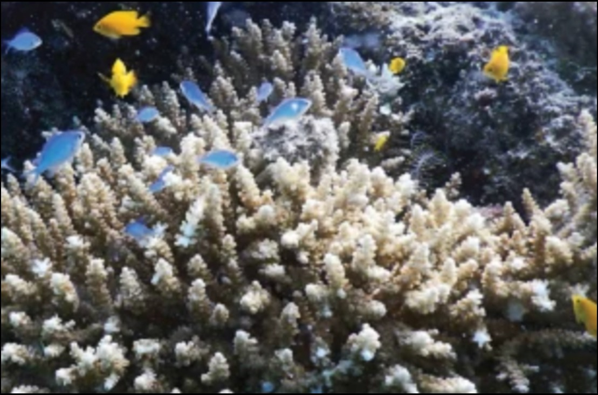
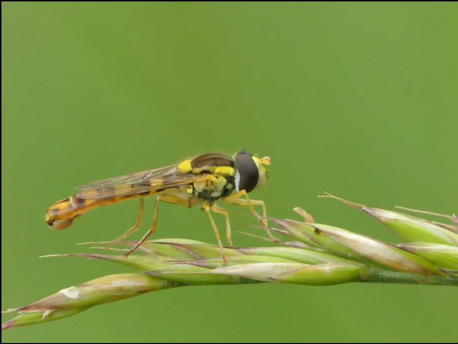

::: {.hero}
::: {.hero-copy}
::: {.partner-logos}

:::

[Un master, deux universités]{.eyebrow}

# Comprendre le vivant. [Explorer ses possibles.]{.serif-accent}

::: {.lead}
Master en biologie des organismes et écologie
:::

Des organismes aux écosystèmes, apprenez à poser les bonnes questions sur le vivant — et à y répondre par le terrain, l’expérimentation et la recherche.

[Découvrir le master →](a-propos.qmd){.button-primary}
[Votre projet commence ici ↗](liens.qmd#admission){.text-link}
:::
::: {.hero-art .biodiversity-mosaic}

Des organismes aux écosystèmes. Une même curiosité pour le vivant.

:::
:::

::: {.facts}
::: {.fact}
**120**

crédits ECTS
:::
::: {.fact}
**2 ans**

pour approfondir votre passion
:::
::: {.fact}
**2 universités**

Namur & Louvain-la-Neuve
:::
::: {.fact}
**Terrain + recherche**

au cœur de la formation
:::
:::

::: {.heritage-banner}
[Depuis 2007]{.heritage-date}

Un master partagé entre l’UCLouvain et l’UNamur, pour former des biologistes capables de comprendre le vivant et ses transformations.
:::

::: {.section-intro}
[Votre curiosité, un point de départ]{.eyebrow}

## Le vivant ne s’arrête pas aux portes de l’auditoire.

Vous vous interrogez sur la biodiversité, les interactions entre organismes et le fonctionnement des milieux naturels ? Le BOE vous invite à transformer cette curiosité en une démarche scientifique, des premières observations à l’analyse des données.
:::

::: {.feature-grid}
::: {.feature}
[01 / Se former]{.eyebrow}

### Construire votre regard

Croisez les approches des milieux terrestres et aquatiques et composez un parcours qui fait place à vos intérêts.

[Le programme →](a-propos.qmd)

[Le stage de terrain en images →](terrain.qmd)
:::
::: {.feature}
[02 / Chercher]{.eyebrow}

### Une question devient votre recherche

Avec le mémoire, prenez part à la vie d’un laboratoire et développez votre autonomie scientifique.

[Les mémoires →](memoires.qmd)
:::
::: {.feature}
[03 / Expérimenter]{.eyebrow}

### Donner un terrain à votre avenir

Le stage est l’occasion de mettre vos compétences en pratique et de préciser votre projet professionnel.

[Les stages →](stages.qmd)
:::
:::

::: {.career-teaser}
::: {}
[Après le BOE]{.eyebrow}

## Biologiste : des métiers, des parcours.

Évaluer les risques d’une substance, accompagner un projet environnemental, protéger la qualité de l’eau ou faire de la recherche en conservation : découvrez comment des diplômées et diplômés mobilisent leur formation.

[Découvrir les métiers et les témoignages →](debouches.qmd){.button-primary}
:::
::: {.teaser-quote}
> « Ce qui est important, c’est de développer une démarche scientifique, une capacité d’adaptation et l’envie d’apprendre en permanence. »

**Sophie-Charlotte Depestel**  
Consultance et gestion de projets chez BE-MAPS
:::
:::

::: {.callout-band}
## Et si c’était votre prochain chapitre ?

Découvrez les conditions d’accès ou échangez avec les responsables du programme.

[Préparer votre candidature →](liens.qmd#admission){.button-light}
[Rencontrer l’équipe](equipe.qmd){.light-link}
:::
