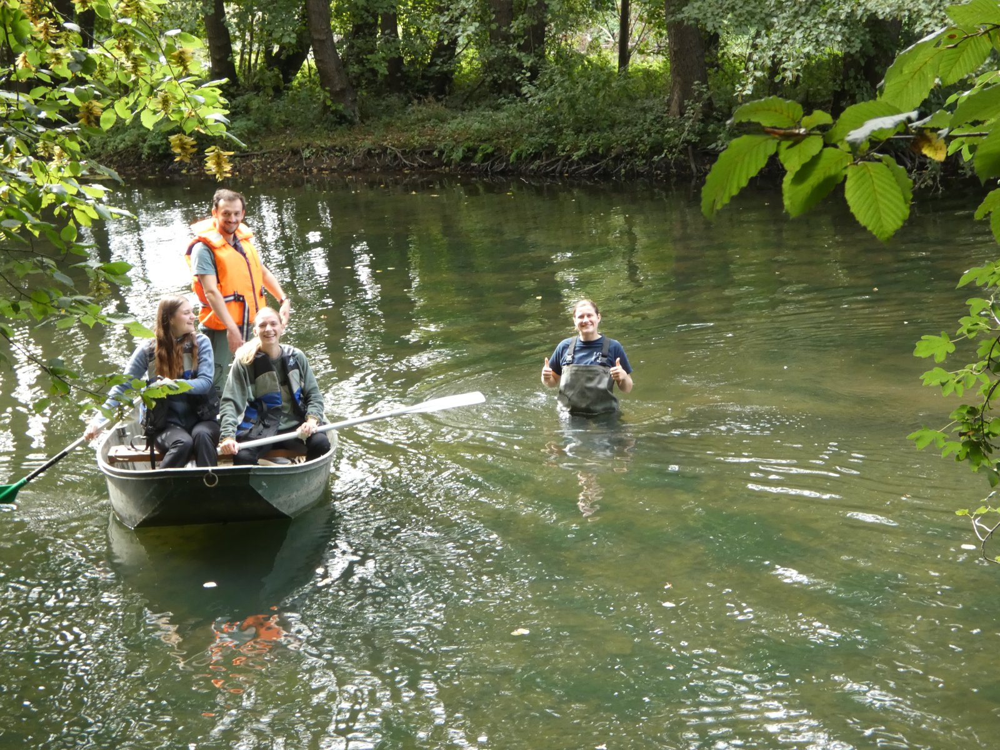

[Mettre vos compétences en mouvement]{.eyebrow}

# Ouvrir le champ des possibles.

::: {.page-lead}
Le stage vous permet d’explorer un environnement professionnel, de mettre vos acquis à l’épreuve et d’affiner la suite de votre parcours.
:::

::: {.facts .stage-facts}
::: {.fact}
**En M2**

au dernier quadrimestre
:::
::: {.fact}
**16 à 19 semaines**

pour une immersion prolongée
:::
::: {.fact}
**Ici ou ailleurs**

une ouverture à l’international
:::
:::

::: {.split-section}
::: {}
## Apprendre dans un autre contexte

Pendant le stage, votre formation rencontre de nouvelles questions, de nouvelles méthodes de travail et une nouvelle équipe. C’est le moment de mobiliser vos acquis, mais aussi d’identifier ce que vous souhaitez encore apprendre.

Une expérience à l’étranger est possible. Le projet et les modalités d’accueil se préparent avec l’équipe du programme.
:::
::: {.note-panel}
### Plus qu’une ligne sur un CV

Quelles missions vous intéressent ? Dans quel environnement aimez-vous travailler ? Quelles compétences souhaitez-vous développer ? Le stage et le projet professionnel vous invitent à préciser vos réponses.
:::
:::

## Une expérience à réfléchir, à vivre et à partager

::: {.feature-grid}
::: {.feature}
### Avant

Identifier vos intérêts et préparer un projet cohérent avec votre parcours.
:::
::: {.feature}
### Pendant

Prendre part aux activités de la structure d’accueil et développer votre autonomie.
:::
::: {.feature}
### Après

Présenter votre expérience, prendre du recul et valoriser ce que vous avez appris.
:::
:::

[Parler de votre projet à l’équipe →](equipe.qmd){.button-primary}

## Des expériences en Belgique et à l’international

Les présentations du programme donnent des exemples de structures d’accueil et de stages précédents. Ces exemples illustrent la diversité des possibilités ; les disponibilités et le projet sont à discuter avec l’équipe.

::: {.feature-grid}
::: {.feature}
### En Belgique

Ardennes et Gaume, Natagora, Contrat de Rivière Lesse ou services du SPW liés à la nature, à l’eau et au milieu forestier.
:::
::: {.feature}
### En Europe

Universités d’Édimbourg et de Lausanne, University College London, Max Planck Institute ou parcs naturels en France.
:::
::: {.feature}
### Sur d’autres continents

University of California, Wildlife Conservation Society au Cameroun, Australian Institute of Marine Sciences ou WWF Vietnam.
:::
:::

::: {.field-photo}
{fig-alt="Une équipe mène une activité dans un cours d’eau, avec un bateau près de la berge." loading="lazy"}
:::

## Comment une expérience nourrit un parcours

Cassandra Liévin a effectué son stage à UC Davis avant de rejoindre l’évaluation des risques environnementaux au SPF Santé publique. Anne-Sophie Voisin a également découvert UC Davis pendant sa formation, avant de poursuivre en doctorat puis dans la protection de la qualité de l’eau en Suisse.

[Lire leurs témoignages →](debouches.qmd){.button-primary}
