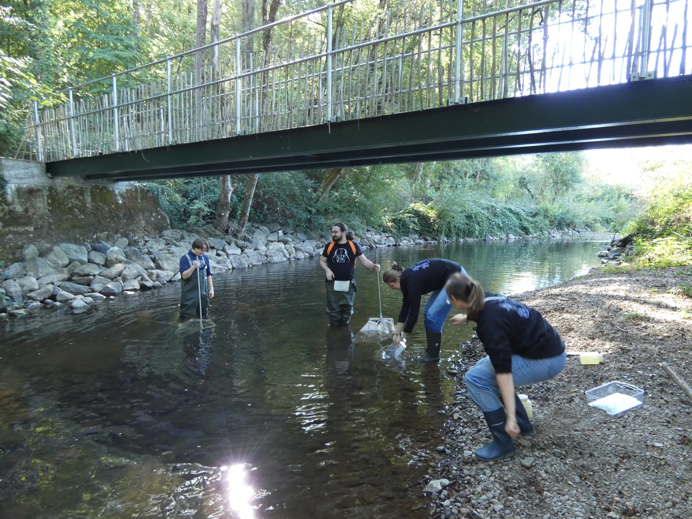
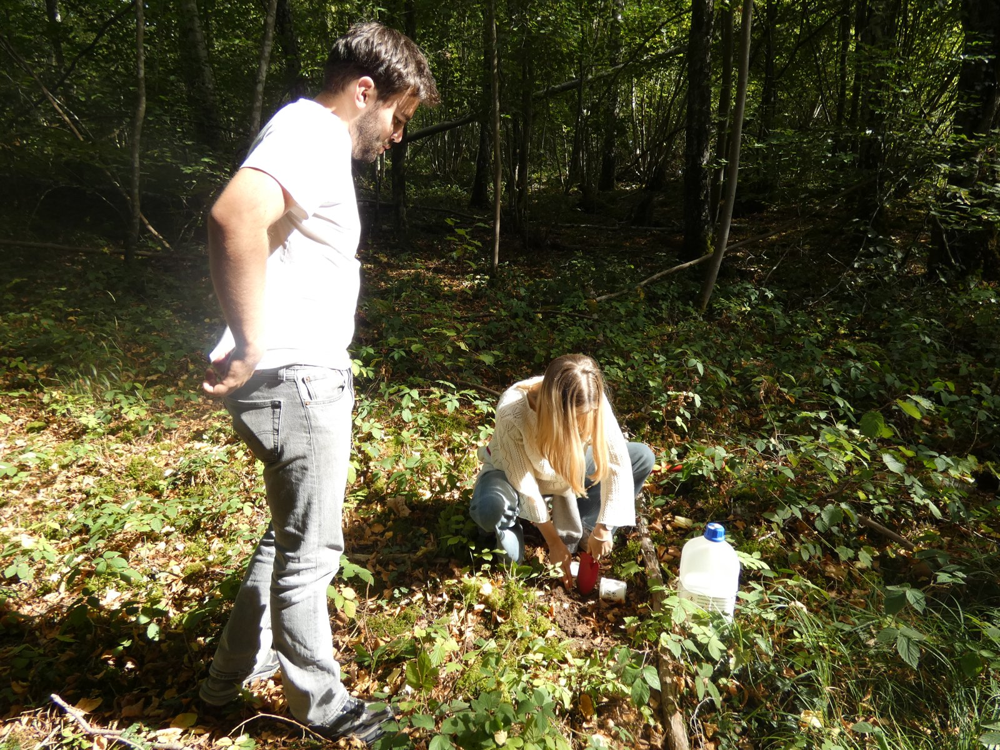
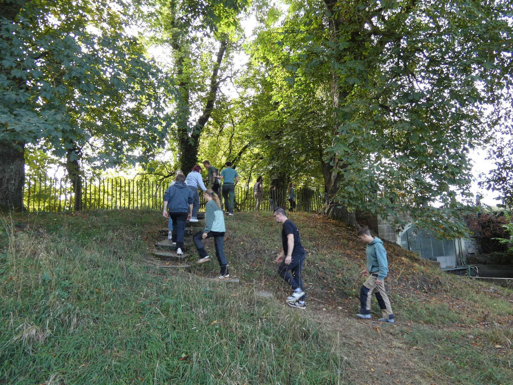
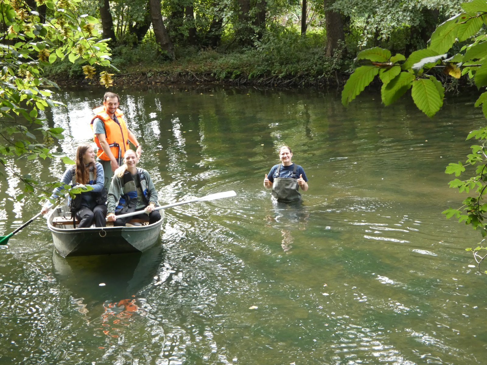
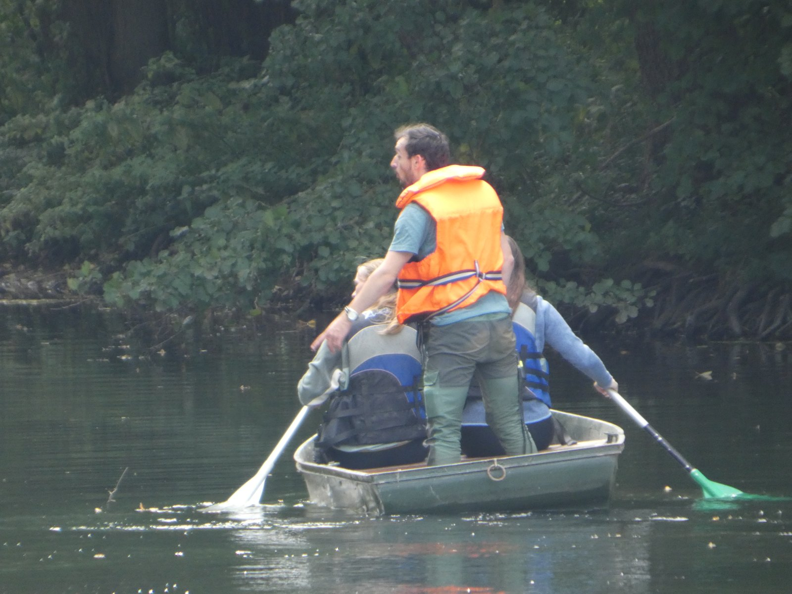
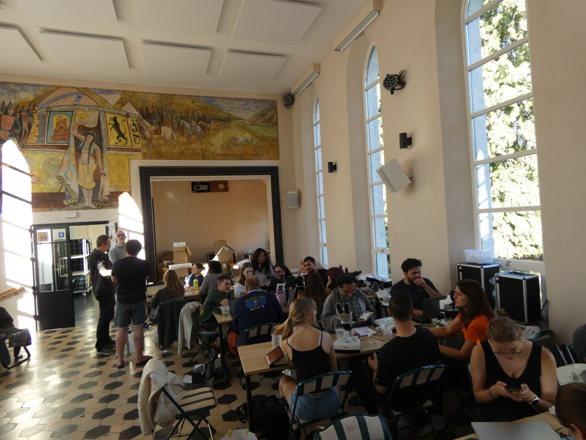
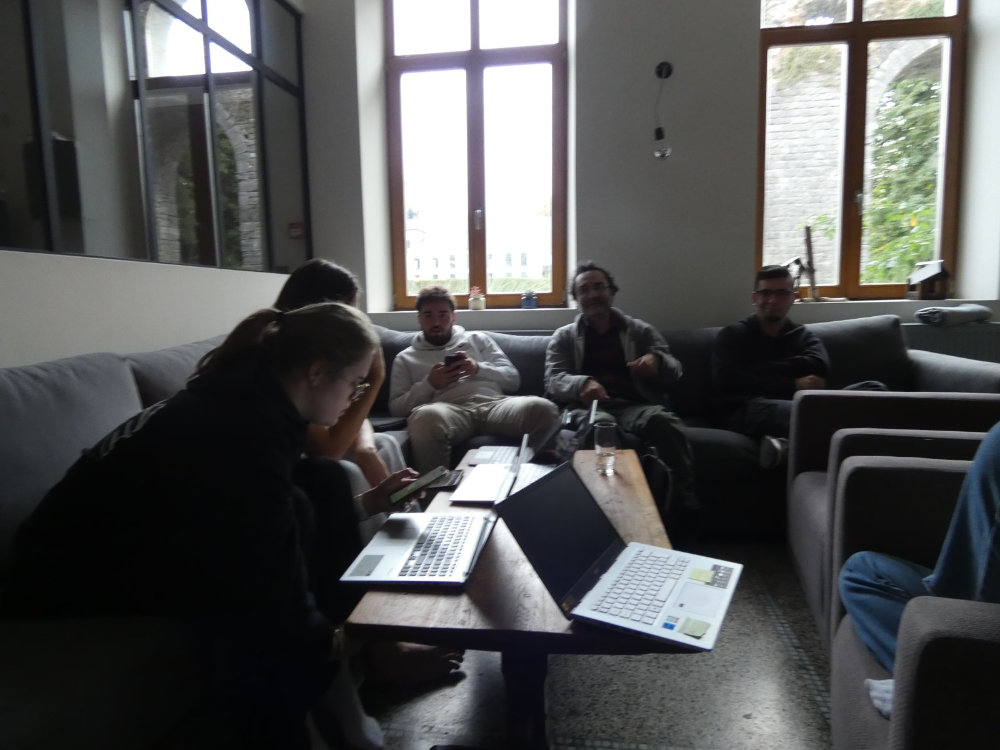

[Le vivant, sur le terrain]{.eyebrow}

# Observer de près. Comprendre ensemble.

::: {.page-lead}
Le cours de terrain en écologie intégrée fait partie du tronc commun du master. Il donne une place concrète à l’observation des milieux et au travail collectif, dès le début de votre parcours.
:::

::: {.field-photo}
{fig-alt="Un groupe travaille dans une rivière peu profonde sous une passerelle."}
:::

::: {.split-section}
::: {}
## Apprendre au contact des milieux

Sur le terrain, les questions prennent une autre dimension. Il faut observer, tenir compte des conditions du milieu, choisir ce que l’on mesure et discuter de ce que les observations permettent de conclure.

Cette expérience collective contribue à relier les connaissances acquises en cours à la diversité des situations rencontrées dans la nature.
:::
::: {.note-panel}
### Deux expériences complémentaires

Le **cours de terrain en écologie intégrée** est un enseignement collectif du master. Le **stage professionnel de deuxième année** est une immersion individuelle dans une structure d’accueil.

[Découvrir le stage professionnel →](stages.qmd)
:::
:::

## Une formation qui se vit aussi dehors

<figure class="terrain-tile"><figcaption>Explorer les milieux boisés.</figcaption></figure>
<figure class="terrain-tile"><figcaption>Observer les paysages et leurs habitats.</figcaption></figure>
<figure class="terrain-tile"><figcaption>Découvrir les milieux aquatiques.</figcaption></figure>
<figure class="terrain-tile"><figcaption>Changer de point de vue.</figcaption></figure>
<figure class="terrain-tile"><figcaption>Mettre en commun les observations.</figcaption></figure>
<figure class="terrain-tile"><figcaption>Analyser et échanger en équipe.</figcaption></figure>

::: {.callout-band}
## Du terrain à votre propre question de recherche

Le mémoire vous permettra ensuite d’approfondir une question scientifique, avec des approches de terrain, de laboratoire ou de modélisation selon le sujet.

[Explorer les exemples de mémoires →](memoires.qmd#exemples){.button-light}
:::
